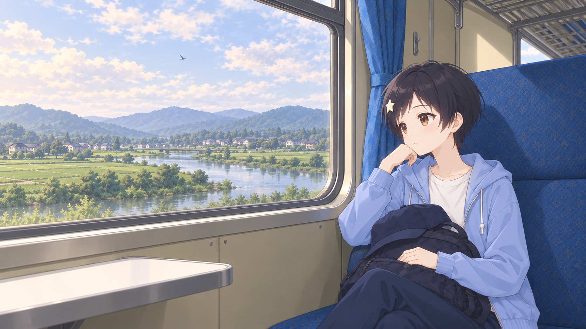

# 想要变成鹰的鱼



一部关于离家、成长与相遇的中文视觉小说，使用 WebGAL 制作。故事从苏雨晴独自远行开始，跟随她寻找工作、住处，以及属于自己的生活。

**[在线试玩](https://verapyuyi.github.io/fish-wants-to-be-a-bird/)** · **[参与章节制作](https://github.com/VeraPyuyi/fish-wants-to-be-a-bird/issues)**

## 关于试玩

目前开放序章，选择会带来局部对白和情绪回响，随后汇合到共同的故事主线。画面采用柔和的动漫风格，人物融入场景，搭配音乐与环境声呈现故事。

## 如何游玩

- 点击画面或按空格、Enter 推进文本，底栏提供回想、自动、快进、存读档、选项和全屏。
- 快进遇到选择会等待操作；到故事最后一句会停下，点击后渐出并播放结尾视频。视频播放时点击画面即可跳过。
- 完整观看结尾视频后，可在“读取存档”中使用“重播结尾视频”。
- 首页“继续游戏”恢复自动记录的进度；手动快速存档可从“读取存档”中的“读取快速存档”恢复，普通编号存档独立保存。

存档保存在当前浏览器、当前站点中。更换浏览器或清除站点数据后，原存档可能无法继续使用。请通过在线地址或本地服务游玩，不要直接双击 `web/index.html`。

## 贡献指南

欢迎一起把后续章节做成可以游玩的视觉小说。章节制作采用 **先提 Issue 确认范围，再提交 PR** 的流程，避免重复制作和剧情衔接冲突。

### 1. 先提 Issue，确认要贡献的章节

开始前请查看已有 Issue，确认目标章节是否已有人负责。新建一个章节认领 Issue，例如 `【章节认领】第009–012章`，说明：

- 想制作的章节范围、主要情节，以及与前后章节的衔接。
- 预计拆分的场景，以及准备复用或新增的人物、背景和音乐。
- 需要讨论的改编取舍、人物时期或素材缺口。

与维护者讨论并确认章节分工后，再开始正式制作；需要扩大范围时，先在原 Issue 中同步。

### 2. 完成对应章节的视觉小说

**剧情**：尽量依据原文，保留主要事件、人物动机与时间顺序。可以适当压缩重复叙述，加入合理的情节连接、情感增强和环境氛围描写；涉及重大删改或新增主线情节时，先在 Issue 中讨论。提交时注明章节与场景依据，区分原文内容和设计补充。

**人物与画面**：尽可能复用项目中已确认的人物形象，可以在此基础上制作表情、动作、服装等差分，尽量不要大幅重设面容和体型。注意头身比例、相对身高、发饰，以及不同时期的发长、假发和装束。同一连续场景保持服装与道具一致；不同场景可依据原文更换服装。背景与人物保持统一画风，人物的位置、透视和受光应自然。已有场景能够复用时，优先复用。

**音乐与声音**：可以复用项目中已有的音乐，也可以自行设计原创配乐。音乐应贴合场景情绪和整体叙事风格，注意音量、循环与转场，避免突兀或喧宾夺主。新增音频请说明来源、作者及适用许可；复用已有素材时也请保留相应署名。

**可玩性**：提交的章节应能从头到尾游玩，选择分支能够继续推进，画面与声音在合适的剧情位置出现。检查前后场景衔接，以及存读档、自动和快进后的表现。

### 3. 提交 PR，关联已确认的 Issue

完成后提交 Pull Request，并关联章节认领 Issue，例如在描述中写 `Closes #123`。PR 中请附上：

- 已完成的章节和场景范围，以及主要改编说明。
- 新增或复用的素材清单；人物差分附上对应的已有参考图。AI 生成图片请同时附上生成／修订 Prompt、图片编号与版本。
- 关键画面截图或短演示，以及本地游玩的检查结果。
- 尚未完成的部分或需要维护者确认的问题。

一个 PR 尽量对应已确认的一段章节范围，方便审阅和整合。根据反馈修订，通过审阅后再合并。

## 本地预览与检查

安装 Python 3 后，在仓库根目录运行：

```sh
python3 serve.py --open
```

保留服务窗口，在浏览器中游玩。现有序章的脚本与资源检查命令为：

```sh
python3 tools/engine_validate.py
```

该检查用于现有序章，新增章节仍需自行通玩，并在 PR 中说明检查范围。

## 工程与素材

- `web/art-prompts/`：[全部图像生成与修订 Prompt](web/art-prompts/README.md)，含当前图片对照表、历史版本及参考说明。
- `web/game/scene/`：WebGAL 原生场景脚本，现有序章入口为 `start.txt`。
- `web/game/background/`、`web/game/figure/`：场景与人物素材。
- `web/game/bgm/`、`web/game/vocal/`：音乐与音效。
- `web/game/template/`：界面样式；`web/engine-source/`：引擎定制源码及重现说明。

公开仓库不包含原著全文、内部制作记录和临时原料。引擎、字体、图像及音频的署名与适用许可见 [引擎许可](web/LICENSE-WebGAL-MPL-2.0.txt)、[字体署名](web/CREDITS-FONTS.txt)、[图像署名](web/CREDITS-ART.txt) 和 [音频署名](web/CREDITS-AUDIO.txt)。代码许可不代表原作或素材的再授权。
